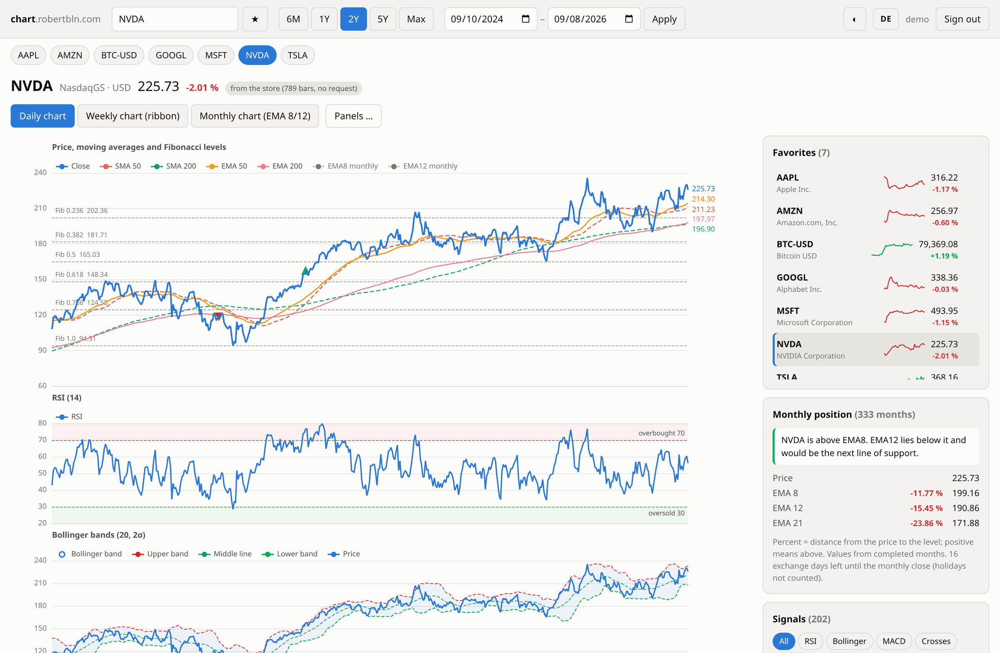
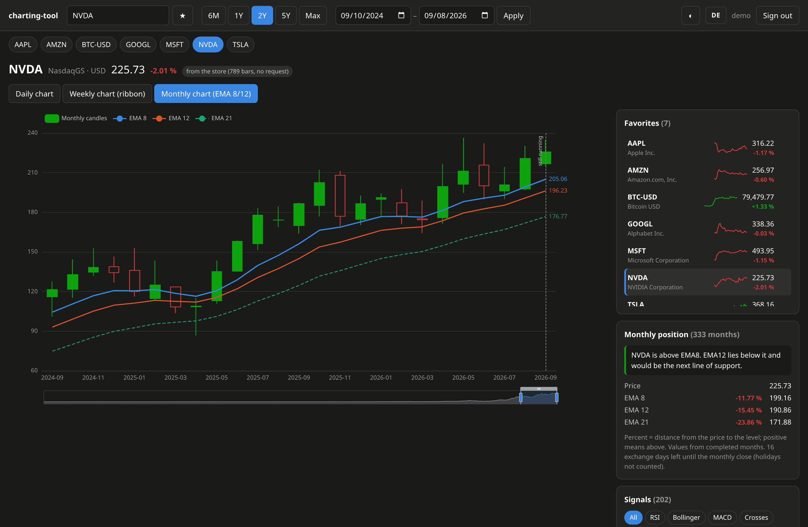

# charting-tool

A small, self-hosted stock charting web app: daily, weekly and monthly price
charts with the usual technical indicators, a watchlist, an automatically
derived signal list and a portfolio tracker — behind a sign-in with user
groups, for a handful of users.

Price data comes from the public Yahoo Finance endpoints. No API key, no
account, no third-party JavaScript: everything, including the charting
library, is served from your own host.

**Interface language:** German by default, switchable to English at any time
with the `DE`/`EN` button in the top bar — a plain link that stores the choice
in a cookie and reloads, so no client-side script has to be allowed past the
Content-Security-Policy. The code itself is English throughout.



---

## What it does

**Three charts per symbol**

| Tab | Contents |
|---|---|
| Daily | Up to seven stackable panels: price with SMA/EMA 50 and 200, Fibonacci retracement levels and golden/death crosses, RSI (14), Bollinger bands (20, 2σ), a red ribbon (SMA 12 against SMA 30), MACD (12, 26, 9), volume with spikes highlighted, and the VIX |
| Weekly | Candles with a SMA 10/12/30 ribbon |
| Monthly | Candles with EMA 8/12/21, plus a "monthly position" card that says where the price stands relative to the settled EMA levels |

The panels of the daily chart can be reordered and switched off individually;
the arrangement is stored per user. All panels share one time axis, one zoom
and one crosshair, and each carries its own tooltip box with the values at the
cursor.

**Signal list.** Every RSI extreme, Bollinger touch, MACD crossover,
golden/death cross, Fibonacci approach and monthly close below EMA8/EMA12 in
the visible window, filterable by kind. Clicking an entry jumps the chart to
that date.

**Watchlist** with the current price, the daily change and a sparkline, plus a
quick-select row in the header. **Notices** flag favorites whose daily RSI is
at or beyond 30/70.

**Key figures next to the price:** the **beta** against the S&P 500 (five
years of monthly returns, as Yahoo defines it; weekly returns for young
listings, flagged as uncertain) and the **free cash flow** of the last twelve
months, with operating cash flow, capital expenditure, the year before and
the last fiscal years on hover.

**Comparison.** A second symbol can be laid over the price panel of the daily
chart. It is rescaled so that both lines start at the same point on the first
day of the window; the panel then shows both changes in percent, and the
moving averages step back so the two closes stand out.

**Portfolio Tracker** — for following the published trades of someone else
(a newsletter, a community, a channel):

- Trades are entered by hand, or a whole post is pasted ("I'm adding; 30
  shares of AAPL at an average cost of $190.") and read out into editable
  rows before saving. A sell without a count closes the position; a trade
  without a price is valued at that day's close and marked as estimated.
- Lots are matched first in, first out. Open positions show shares, average
  cost, today's price and change, invested and current value, result, weight
  and beta, sortable by any column; closed trades show cost, proceeds and
  result, both with a total row.
- Figures for the whole journal: invested, open and realized result, today's
  change, the money-weighted return (**IRR**, like Excel's XIRR) and the
  true time-weighted return (**TTWROR**, as in Portfolio Performance).
- Buys and sells appear as pins in the daily chart of the symbol, with a line
  at the average cost of what is still held.

The journal is shared: admins enter it, members of the `portfolio` group can
read it.

The monthly chart, here in the dark theme, next to the card that reads the
price against the settled EMA levels:



## How it is put together

```
Browser ──► reverse proxy (TLS) ──► container :8080 ──► Yahoo Finance
                                          │
                                          └──► SQLite on a bind mount
```

- **Backend:** FastAPI + uvicorn, Python 3.13. No ORM — SQLite in WAL mode.
- **Frontend:** one page, plain JavaScript, [Apache ECharts](https://echarts.apache.org/)
  served locally. No build step, no bundler, no npm at runtime.
- **Price store:** bars are fetched once and kept. A later request loads only
  the missing stretch — switching from one year to two fetches the missing
  first year, not the whole series. Retroactive changes (stock splits) are
  detected by overlapping the last few bars on every reload.
- **Indicators** are computed over the full loaded history and only then cut
  to the visible window, so they have already settled at the left edge of the
  chart.

### Layout

```
app/
  src/
    main.py         FastAPI app: routes, sign-in, API
    i18n.py         all user-facing texts, German and English
    auth.py         Argon2id passwords, server-side sessions, lockout
    db.py           SQLite schema and access
    store.py        price store, fetches only what is missing
    yahoo.py        Yahoo Finance client
    indicators.py   SMA, EMA, RSI, MACD, Bollinger, Fibonacci
    signals.py      signal detection
    series.py       assembles the response for the frontend
    portfolio.py    portfolio tracker: reading posts, FIFO ledger, IRR, TTWROR
    beta.py         beta against the S&P 500 from the price store
    fundamentals.py free cash flow from Yahoo
    notices.py      RSI notices for the favorites
    cli.py          user management on the command line
  static/           app.js, admin.js, style.css, ECharts, icons
  templates/        index.html, login.html, admin.html
Dockerfile
docker-compose.yml
```

---

## Running it

### Requirements

Docker with the Compose plugin. Nothing else — Python, the dependencies and
the charting library all live in the image.

### Setup

```bash
git clone git@github.com:robertbln/charting-tool.git chart
cd chart
```

Create the `.env` file. `SECRET_KEY` is the only value without a default and
the application refuses to start without it:

```bash
cat > .env <<EOF
SECRET_KEY=$(python3 -c "import secrets; print(secrets.token_hex(32))")
EOF
```

Point the data directory at a location on your host and start it:

```bash
mkdir -p /srv/docker-volumes/chart/data
docker compose up -d --build
```

Create the first user — the password is asked for interactively and needs at
least 12 characters:

```bash
docker compose exec chart python -m src.cli adduser yourname
```

**The first user becomes the admin.** As long as no account holds the admin
group, `adduser` gives a new user `admin` and `general`; everybody created
after that starts in `general` only. To decide it yourself, name the groups:

```bash
docker compose exec chart python -m src.cli adduser yourname --groups admin,general
```

Further users are best created on the user management page (see below).

The app now listens on `127.0.0.1:8133`. Open it through a reverse proxy (see
below), or change the port mapping in `docker-compose.yml` to reach it
directly.

### Configuration

Everything is set through the environment, usually in `.env`. Only
`SECRET_KEY` is mandatory.

| Variable | Default | Meaning |
|---|---|---|
| `BRAND` | `charting-tool` | Name in the top bar and above the sign-in form. Everything up to the first dot is set in the strong colour, the rest muted — `chart.example.com` reads as one name in two weights. |
| `SECRET_KEY` | — | At least 32 characters. Generate with `python3 -c "import secrets; print(secrets.token_hex(32))"` |
| `DATA_DIR` | `/data` | Directory of the SQLite database and the log, inside the container |
| `SESSION_HOURS` | `12` | Lifetime of a normal session |
| `SESSION_REMEMBER_DAYS` | `30` | Lifetime with "stay signed in" ticked |
| `MAX_ATTEMPTS` | `5` | Failed sign-ins from one address before the lockout |
| `LOCKOUT_MINUTES` | `15` | How long that lockout lasts |
| `CACHE_TTL_INTRADAY` | `900` | Seconds a bar counts as current while the exchange is open |
| `CACHE_TTL_CLOSED` | `43200` | The same once it has closed |
| `COOKIE_SECURE` | `true` | Set to `false` only when serving over plain HTTP |
| `LOG_FILE` | `access.log` | Access log, written into `DATA_DIR` |
| `LOG_MAX_MB` / `LOG_BACKUPS` | `5` / `5` | Rotation of that log |
| `LOG_TIMEZONE` | `Europe/Berlin` | Time zone of its timestamps |

### Behind a reverse proxy

The container listens on plain HTTP and expects TLS to be terminated in front
of it. The proxy has to set `X-Real-IP`, because the lockout counts against
it — and it has to **set** the header rather than append to it, otherwise a
client can send its own value and slip past the lockout. For Apache:

```apache
RequestHeader set X-Real-IP "%{REMOTE_ADDR}s"
ProxyPass        / http://127.0.0.1:8133/ timeout=120
ProxyPassReverse / http://127.0.0.1:8133/
```

The equivalent in nginx is `proxy_set_header X-Real-IP $remote_addr;`.

If you run it without a proxy over plain HTTP, set `COOKIE_SECURE=false` —
otherwise the browser discards the session cookie and you can never sign in.

### Users and groups

Every user is in one or more groups; the permissions add up. A user without
any group cannot sign in.

| Group | May |
|---|---|
| `admin` | everything, plus entering and deleting portfolio trades and managing users |
| `portfolio` | charts, favorites, notices and the Portfolio Tracker tab, read only |
| `general` | charts, favorites and notices, without the Portfolio Tracker |

**In the browser:** admins find a *Users* button in the top bar (`/admin`).
There they create users, tick groups (saved at once), set a new password,
end a user's sessions and delete accounts. Nobody can take the admin group
from themselves, the last admin keeps it, and one's own account cannot be
deleted there. The page also shows each user's last sign-in and open
sessions.

**On the command line:**

```bash
docker compose exec chart python -m src.cli adduser NAME [--groups admin,portfolio,general]
docker compose exec chart python -m src.cli passwd  NAME          # new password, groups unchanged
docker compose exec chart python -m src.cli groups  NAME          # show the groups
docker compose exec chart python -m src.cli groups  NAME admin general   # set them
docker compose exec chart python -m src.cli sessions              # list sessions
docker compose exec chart python -m src.cli sessions --clear      # end all of them
```

Changing a password ends every session that user has, on every device.
`groups` is also the way back in should the last admin ever lose the group —
the web page refuses that, the shell does not.

**Upgrading an installation from before the groups:** on the first start
every existing user is put into `general`, and the oldest account — normally
the one that set the installation up — into `admin` as well. Nobody is
locked out; give the others further groups afterwards. Users and groups live
only in the database, never in the repository.

### What to back up

`DATA_DIR` (users and their groups, sessions, watchlist, the portfolio
journal, the price store and the log) and the `.env`. Everything else is rebuilt from the repository. Losing the price store
costs nothing but a few requests to Yahoo.

---

## Security

The app is meant to sit on the open internet behind TLS, so a few things are
deliberate:

- **Argon2id** password hashing with parameters above the library default, and
  a fixed quarter-second delay on every sign-in attempt.
- **Server-side sessions.** The cookie carries a random token and nothing
  else; `HttpOnly`, `SameSite=Strict`, `Secure` by configuration. A password
  change invalidates every existing session.
- **Lockout by address**, not by username — otherwise anyone knowing a name
  could lock the legitimate user out at will.
- **CSRF** on the sign-in form via a double-submit cookie, compared in
  constant time. Every request that changes something must in addition carry
  an `X-Requested-With` header, which a foreign page cannot set without a
  CORS preflight the app never answers.
- **Permissions are checked on the server** for every call; hiding a tab or a
  button in the interface is a courtesy, not the protection. Changes in the
  user management are written to the access log.
- **Content-Security-Policy** without `unsafe-inline` and without foreign
  origins; everything is served locally. Plus `nosniff`, `X-Frame-Options:
  DENY` and `Referrer-Policy: same-origin`.
- **Failed sign-ins are logged** in a form a fail2ban jail can act on.
- The container runs as an unprivileged user with `no-new-privileges`, all
  capabilities dropped, and memory, CPU and PID limits.

Responses from Yahoo are validated for shape before use, and every individual
price value is coerced to a number or discarded — a malformed response yields
a readable error, not a 500.

## Data from Yahoo

Three public endpoints, none of which needs an account or a key:
`v8/finance/chart` for prices, `v1/finance/search` for the symbol search and
`ws/fundamentals-timeseries` for the free cash flow (ready-made TTM, per year
and per quarter, also for non-US listings). The beta is computed here from
the stored prices, since the endpoints that carry one want a cookie and
crumb. All three are unofficial; if the fundamentals call fails, only the FCF
figure is missing. Yahoo's data is meant for personal use.

## Adding a language

`app/src/i18n.py` holds everything the server renders — including the texts
of the user management page, which `admin.js` receives as a JSON data block —
and `app/static/app.js` (the `TEXTS` table at the top) everything the
browser draws. Add a third key to both, extend `LANGUAGES` in `i18n.py`, and add a
link to the switch in `templates/index.html`. The keys are identical on both
sides for anything that appears in both places.

## License

Not specified yet — add a `LICENSE` file before others rely on this.
